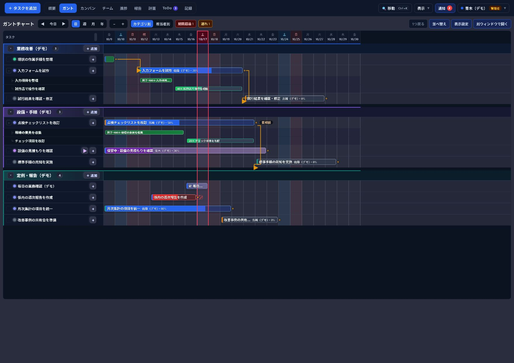
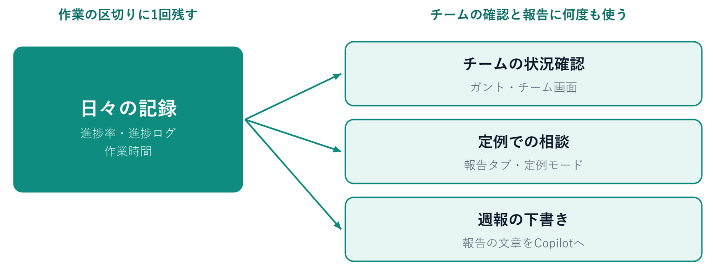
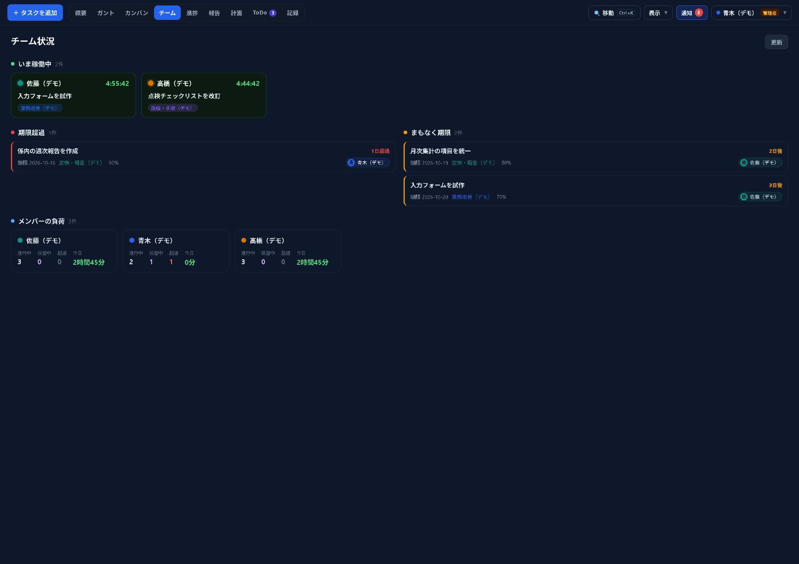
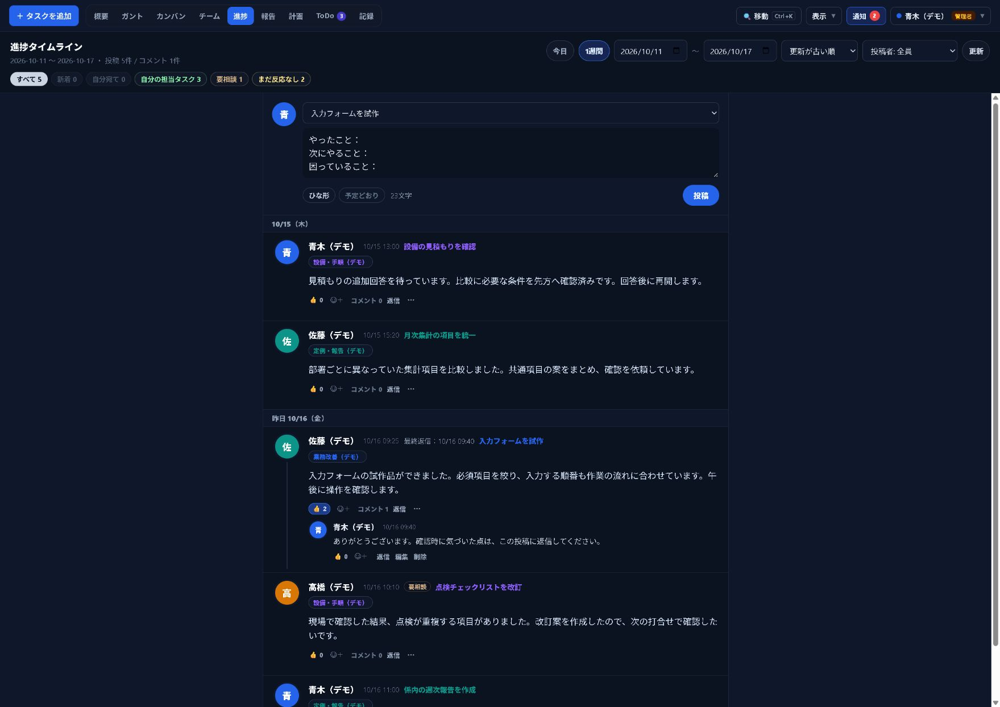
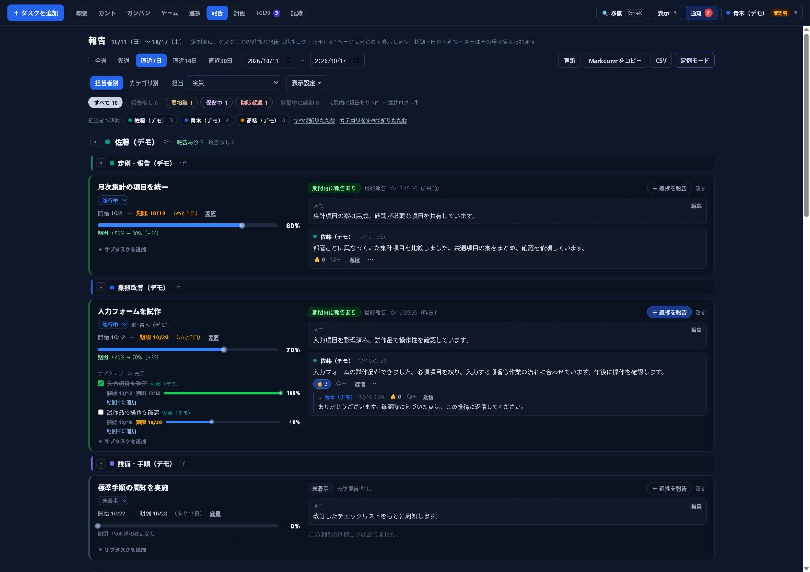
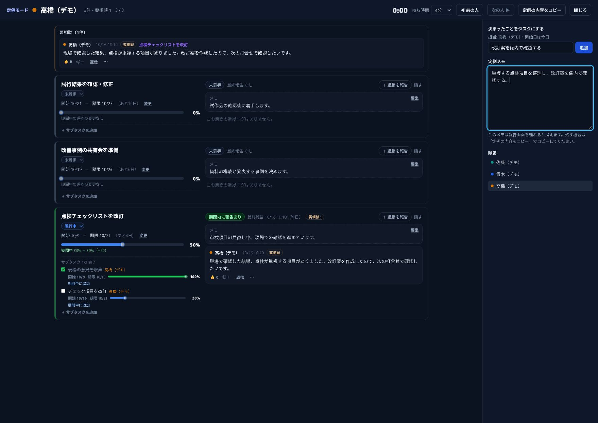
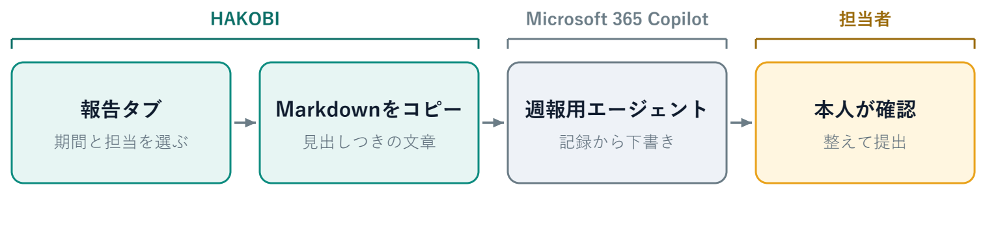
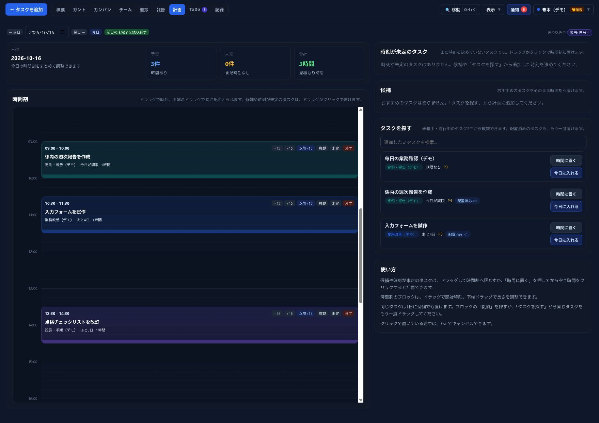
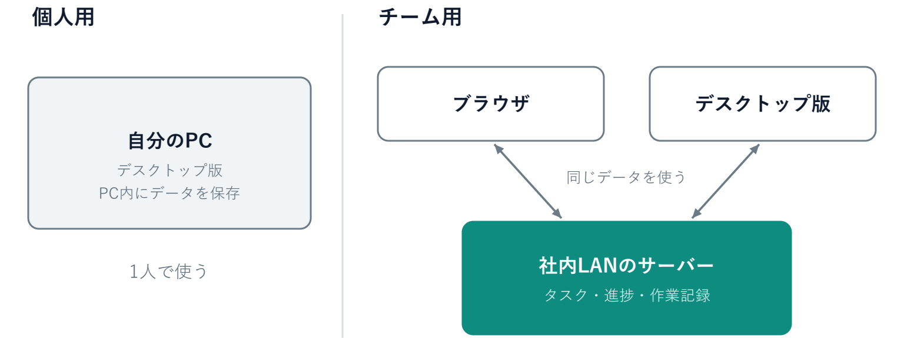
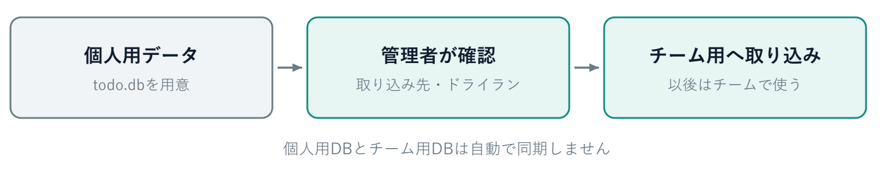

# チームの仕事が見える業務管理ツール HAKOBI を作りました

> 社内レポート　2026年10月

HAKOBI（運び）は仕事の日程・担当・進捗をガントチャートで共有する業務管理ツールです。係やグループの仕事を、メンバー全員が同じ画面で確かめられるようにしたいと考えて作りました。

:::summary このレポートの要点
1. 仕事の状況を知るために本人へ聞き直したり、報告のたびに一から書き直したりする手間を減らすために作りました。
2. 作業の区切りに残した短い記録を、チームの状況確認、定例での相談、週報の下書きに使えます。
3. 個人でもチームでも使えます。いま進めている仕事を1件登録するところから試せます。
:::



## 作ったきっかけ

### チームの仕事で生じる手間

係やグループで仕事を進めていると、ほかの人の仕事がどこまで進んでいるかは、本人に聞かないと分からないことがあります。定例や週報の前には思い出しながら別の一覧を作り、報告のたびに同じ内容を一から書き直す手間もかかります。

### ねらい

HAKOBIはこうした手間を減らすために作りました。チームの予定・担当・進捗を同じ画面で共有し、だれが何を進めていて、どの仕事の期限が近いかを、その場で確かめられるようにすることがねらいです。

人に聞いて集めていた仕事の状況を日々の記録から確かめられるようにすれば、チームの見える化とDXを身近な仕事から進められると考えています。

### 一度残した記録を何度も使う

HAKOBIでは、作業の区切りに残した記録を次の確認や報告にそのまま使います。進捗率や短い進捗ログを一度残せば、チームの状況確認、定例での相談、週報の下書きのそれぞれに使えます。



### 個人用から始まったツール

HAKOBIは2026年3月に、1人で使うデスクトップアプリとして作り始めました。5月に、社内LANのサーバーで複数人が同じデータを使えるチーム用を加え、その後も報告タブや定例モードなど、定例と週報で使う機能を足してきました。

## チームで使うと変わること

### これまでとの違い

| 場面 | これまで | HAKOBIを使うと |
| --- | --- | --- |
| 仕事の状況を知りたいとき | 本人に聞き直す | ガントとチーム画面で、担当・期限・進捗と、いま計測中の仕事を確かめる |
| 定例の準備 | 思い出しながら別の一覧を作る | 報告タブで、期間中の進捗・記録・期限の変更をまとめて見る |
| 週報の作成 | 報告のたびに一から書き直す | 報告タブの文章をCopilotに渡して下書きを作り、本人が確かめて提出する |

チームでの変更はリアルタイムでメンバーの画面に反映されます。ブラウザとデスクトップ版のどちらからでも、同じチームのデータを使えます。

### 1週間の流れ

すべての画面を覚える必要はなく、場面に合う画面から使えます。たとえば1週間は次のように進みます。

| タイミング | すること | 使う画面 |
| --- | --- | --- |
| 朝 | 今日の予定と期限を確かめる | ガント、計画 |
| 作業中 | タイマーで作業時間を記録し、区切りに進捗ログを残す | タイマー、進捗 |
| 相談したいとき | 進捗ログに要相談の印を付け、@名前で相手に知らせる | 進捗 |
| 定例 | 要相談から話し、決まったことをその場でタスクにする | 報告、定例モード |
| 週の終わり | 報告の文章から週報の下書きを作る | 報告、Copilot |

## チームの仕事が見える

### ガントで日程と担当を見渡す

ガントを開くと、どの仕事がいつまでに必要で、だれが担当し、どこまで進んでいるかを1つの画面で確かめられます。サブタスクを開けば、業務全体と個々の作業を同じ時間軸で見られます。

バーはドラッグで動かせ、端をつかんで開始日や期限を変えられます。「集計項目を決める」「入力フォームを作る」のように順番がある仕事は依存関係で結んでおくと、前の仕事の日程を変えたときに後ろの仕事の日程が計算し直されます。

バーの色は入力した日程と進捗から計算した遅れや期限超過の目安です。色が気になる仕事は進捗ログや本人の話と合わせて確かめてください。

### チーム画面で今の状況をつかむ

チーム画面には、メンバーがいま計測している仕事、期限を過ぎた仕事と期限が近い仕事、メンバーごとの担当件数と今日の作業時間が並びます。仕事の偏りや、手助けが必要な案件を話し合う材料になります。「いま稼働中」に出るのは、タイマーで計測している仕事です。



### 進捗ログで状況と相談を残す

作業の区切りに、進捗率を更新して短い進捗ログを残します。「ひな形」を押すと「やったこと」「次にやること」「困っていること」が入力欄に入り、大きな変化がなければ「予定どおり」で一言だけ投稿できます。

判断や手助けが必要なときは「要相談」の印を付けます。返信やリアクションで確認を伝えられ、@名前で相手に知らせることもできます。ほかの人の投稿や返信は新着表示や通知から確かめられます。



## 記録を定例と週報に使う

### 報告タブで定例の準備をする

報告タブで期間を選ぶと、担当者別またはカテゴリ別に、進捗の変化、期限、メモ、進捗ログと返信がまとまって表示されます。定例の前に、思い出しながら別の一覧を作る手間を減らせます。

会議の前には次の点を確かめておきます。

- 期間中に何が進んだか。進捗の変化と進捗ログを見ます。
- どこに判断や手助けが必要か。要相談と保留の理由を見ます。
- 期限を調整する必要があるか。期限の変更や、報告がしばらくない仕事を見ます。

進捗率、期限、メモ、サブタスク、進捗ログは、この画面からも更新できます。定例で決まった内容を反映するために、毎回詳細画面へ戻る必要はありません。



### 定例モードで1人ずつ話す

報告タブを担当者別にして「定例モード」を開くと、担当者ごとに大きく表示して進められます。持ち時間を選び、経過時間を見ながら、要相談の内容から順に話せます。

追加の確認や対応が決まったら、その場でタスクを作れます。会議で話した内容を、担当者の次の仕事として登録できます。

定例メモ、追加したタスク、担当者ごとの時間は「定例の内容をコピー」でまとめて取り出し、議事録に貼れます。定例メモは報告画面を離れると消えるので、残すときは先にコピーしてください。

管理者が定例の曜日を設定すると、条件に当てはまる未報告の担当タスクについて、前日の17時以降に報告を促す通知を出せます。



### 週報はCopilotで下書きする

報告タブの「Markdownをコピー」を押すと、表示中の進捗や記録を、見出しと箇条書きの付いた文章としてコピーできます。この文章をMicrosoft 365 Copilotで作った週報用のエージェントに貼り付けると、週報の下書きを作れます。

週報の書き方をエージェントに保存しておけば、毎週の依頼は対象期間と記録を中心に入力できます。下書きが出たら、担当者、期限、進捗率、相談事項、未確定の内容を本人が確かめてから提出します。エージェントの作り方と指示の例は付録Aにまとめました。



## 自分の仕事も整理しやすい

チームで共有する機能のほかに、自分の仕事を進めるための機能もあります。必要なものから使えます。

| 機能 | できること |
| --- | --- |
| 計画 | 今日取り組む仕事を時間割に並べ、15分単位で調整したり、前日に終わらなかった仕事を繰り越したりする |
| タイマーと記録 | タスクにひも付けて作業時間を記録し、あとから作業内容と時間を振り返る |
| ToDoリスト | 毎朝の点検や週ごとの確認を、周期が変わると未チェックに戻る項目として管理する |
| 繰り返し | 週次の資料作成や月次の集計のように、完了すると次回のタスクを作る |
| カンバン | 仕事を状態ごとのカードで整理し、回答待ちの仕事は保留にして保留の期間を残す |
| テンプレートと複製 | 似た業務を複製やテンプレートで登録し、複数行をまとめて追加する |
| 移動・操作パレット | Ctrl＋Kでタスクや画面を探し、タスクを追加する |
| デスクトップ版 | チームに接続すると、ミニタイマー、進捗のクイック投稿、トレイ操作、OS通知と未読バッジを使える |



## 仕組みとデータの扱い

### 構成

HAKOBIはデスクトップ版とブラウザ版で同じ画面を使います。個人用はPC内に、チーム用は社内LANのサーバーにデータを保存します。デスクトップ版をチームに接続したときも、サーバーのDBファイルへ直接はつながず、ブラウザと同じくサーバーを通して同じデータを使います。



| 部分 | 使っている技術 |
| --- | --- |
| 画面 | ReactとTypeScript（デスクトップ版とブラウザ版で共通） |
| デスクトップ版 | Electron。個人用はPC内のSQLiteにデータを保存する |
| チーム用サーバー | Node.js（Express）とSQLite。WebSocketで変更を各画面へ知らせる |

### データとアカウント

- チーム用は社内LANで使う前提で、インターネットへの公開は想定していません。
- アカウントは管理者が発行します。自分で登録する機能はなく、パスワードはハッシュ化して保存します。各自のパスワードは設定から変更できます。
- サーバーは1日1回、自動でDBのバックアップを取ります。既定では14個まで残し、残す数は設定で変えられます。管理者は現在のDBをダウンロードすることもできます。
- 週報の例は人がMarkdownをコピーしてCopilotに渡し、下書きの内容を確かめる運用です。

## 導入の進め方

### 向いている仕事

最初からすべての業務を登録する必要はありません。次のような仕事から試すと、同じ記録を定例と週報に使えるかを確かめやすくなります。

- 定例で進捗を確認している仕事
- 状況を聞き直すことが多い仕事
- 毎週の週報にまとめている仕事
- 毎朝の点検や、週ごとの確認がある仕事

### 個人用とチーム用

1人で使う場合は、デスクトップ版の個人用を選びます。係やグループで使う場合は、社内LANにサーバーを用意し、各自がブラウザかデスクトップ版で接続します。1つのサーバーで6人程度のチームを想定しています。

| 比較する項目 | 個人用 | チーム用 |
| --- | --- | --- |
| 利用する画面 | デスクトップ版 | ブラウザまたはデスクトップ版 |
| データの保存先 | 自分のPC内 | 社内LANのサーバー |
| 主な使い方 | 自分の仕事や時間を整理する | 担当を分け、進捗と相談を共有する |
| メンバーの管理 | 不要 | 管理者がアカウントを発行する |

### 試すときにそろえること

試すメンバーで、次のことをそろえます。

1. 最初に扱う業務と主担当を決める。
2. 作業の区切りに進捗ログを残し、判断が必要なら要相談を付ける。
3. 定例では報告タブを開き、決まった対応をタスクにする。
4. 週報は報告の文章から下書きを作り、提出前に本人が確かめる。

### 書く場所の使い分け

タスクの説明・メモ・進捗ログに書く内容を分けておくと、仕事の目的、今の状況、これまでの経緯をそれぞれ追えます。

| 書く場所 | 書く内容 | 例 |
| --- | --- | --- |
| 説明 | 仕事の目的や進め方 | 集計項目の違いを整理し、係で使う様式をそろえる |
| メモ | 今の状況（書き換えて使う） | 関係先へ確認中。回答を受けたら様式を確定する |
| 進捗ログ | 日付つきで積み上がる報告 | 10月16日　試作を確認。入力項目の追加を相談したい |

### 使い始め方

チームのサーバーがある場合は、管理者にサーバーURLとアカウントを確かめ、ブラウザでログインします。デスクトップ版を使うときは、サーバーの「/download」ページからインストーラーを入手し、接続先に同じサーバーURLを登録します。デスクトップ版の新しいバージョンをサーバーで公開すると、アプリにお知らせが出ます。インストールは各自が行います。

個人で試す場合は、デスクトップ版で個人用を選びます。個人用で作ったタスクは、あとから管理者がチーム用へ取り込めます（付録B）。

最初は「タスクを追加」から担当業務を1件登録し、進捗ログを1件残して、報告タブに出ることを確かめてください。ほかのメンバーにも同じ仕事が見えるかを一緒に確かめると、使い方を共有できます。

### 運用担当者が用意すること

サーバーの保存先、接続先URL、管理者、メンバーのアカウントを用意します。グループごとにデータを分ける場合は、サーバーとDBの保存先を分けて運用します。設定の「チーム管理」ではユーザー管理、定例の曜日、個人用データの取り込み、バックアップを扱えます。サーバーの準備、配布、バックアップからの復元の手順は「HAKOBI 運用ガイド」（docs/HAKOBI.md）にまとめています。

### 使うときの注意

- 報告タブの「期間内の報告なし」は期間内に進捗ログやメモの更新がないことを示します。仕事をしていないという判断には使わず、本人に状況を確かめてください。
- カテゴリの「集計外」は集計の対象を分ける設定で、ほかの人から見えなくする設定ではありません。
- テンプレートは各自の端末に保存されます。
- チーム用はサーバーへの接続が必要です。再接続中の帯が出たときは、接続状態を確かめてください。

## おわりに

まずは、いま進めている仕事を1件登録し、作業の区切りに進捗ログを残してみてください。その記録が報告タブに並び、定例や週報の材料になることを確かめられます。

係やグループで試してみたいときや、使い方を相談したいときは、作成者まで声をかけてください。

## 付録A 週報用エージェントの作り方

週報を毎回同じ形式で作るなら、Microsoft 365 Copilotに週報用のエージェントを用意する使い方がおすすめです。書き方の指示を保存しておき、毎週HAKOBIの報告Markdownを渡して下書きを依頼します。

### 最初に1回エージェントを作る

1. Microsoft 365 Copilotを開き、「エージェント」から「新しいエージェント」を選びます。
2. 「HAKOBIの報告Markdownを元に週報を作るエージェントを作成したい」と伝えます。
3. 「構成」で名前と指示を確かめます。名前は「HAKOBI週報作成」などにし、下の指示の例を保存します。
4. サンプルのMarkdownで試し、書式と内容を確かめてから作成します。

作成機能の表示は組織の設定やアカウント、ライセンスによって異なります。

### エージェントの指示欄に保存する例

係で使う週報の書式が決まっていれば、出力の見出しや長さを合わせてください。

```text
あなたは係内の週報の下書きを作成する担当です。
今回の依頼に貼り付けられたHAKOBIの報告Markdownと、依頼者が明示した補足だけを根拠にしてください。

最初に対象期間と担当範囲を確認してください。不明な場合は確認を求め、推測で埋めないでください。
業務ごとに内容をまとめ、次の見出しで簡潔な日本語の週報を作成してください。
1. 今週の主な実施内容
2. 継続中の仕事と現在の状況
3. 相談事項と保留中の仕事
4. 次に行うこと
5. 提出前に確認すること

担当者、期限、進捗率、保留の理由は、記録の内容を保ってください。
期間中の進捗の変化と現在の進捗率を混同しないでください。
要相談の記録と返信を読み、解決したと確認できない内容を解決済みにしないでください。
「期間内の記録なし」を「実施していない」という意味に受け取らないでください。
次の作業は記録に明示されたものだけを挙げ、来週の予定や成果を創作しないでください。
足りない情報や食い違いは「提出前に確認すること」に分けてください。
同じ内容は重複させず、業務名と具体的な動きが伝わる文章にしてください。
```

### 毎週の依頼の例

```text
次のHAKOBIの報告Markdownを元に、週報の下書きを作成してください。
対象期間：2026年10月12日〜16日
担当範囲：佐藤（デモ）の主担当業務
提出先：係内の共有
文体：です・ます調
下に貼るMarkdownの期間と担当範囲も確認してください。

ここに「報告」タブからコピーしたMarkdownを貼り付ける
```

依頼例の日付と担当範囲はその週の内容に置き換えます。

出典：Microsoft公式「独自のエージェントを構築する」「Build agents in Agent Builder」（2026年10月17日確認）

[Microsoftのエージェント作成手順](https://support.microsoft.com/ja-jp/microsoft-365-copilot/build-your-own-agent-with-microsoft-365-copilot)
[Microsoft Learnの構成とテストの説明](https://learn.microsoft.com/en-us/microsoft-365/copilot/extensibility/agent-builder-build-agents)

## 付録B 個人用データの取り込み



チームの管理者が設定の「チーム管理」から「デスクトップDBを取り込む」を押します。個人用のtodo.dbと取り込み先のメンバーを選び、まず「ドライラン（確認のみ）」で件数を確かめてから実行します。

タスク、サブタスク、依存関係、作業ログ、予定、進捗ログや返信、変更履歴などを引き継げます。投稿者や担当は指定したメンバーとして取り込まれます。

取り込みは個人用からチーム用へのコピーです。もう一度実行しても、すでに取り込んだデータは更新されません。取り込んだあとも個人用DBとは自動で同期せず、設定や実行中のタイマーなどは取り込みの対象外です。

この資料の画面は2026年10月17日に撮影したデモです。登場する人名、業務名、記録はすべて架空のものです。
