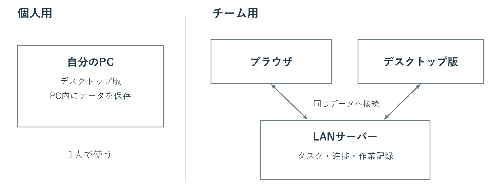
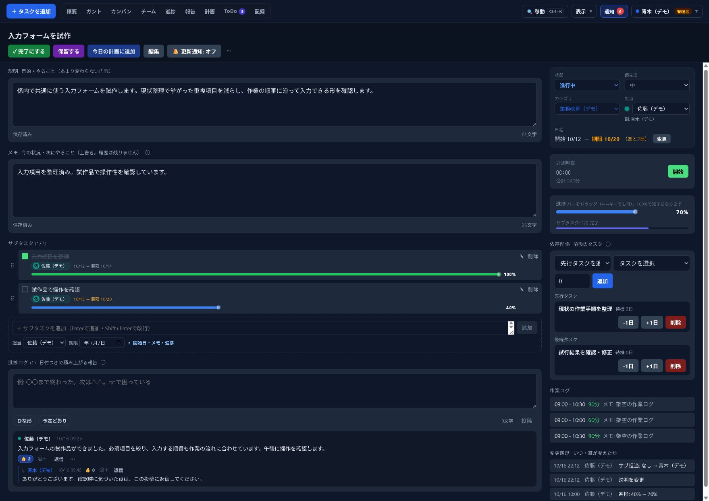
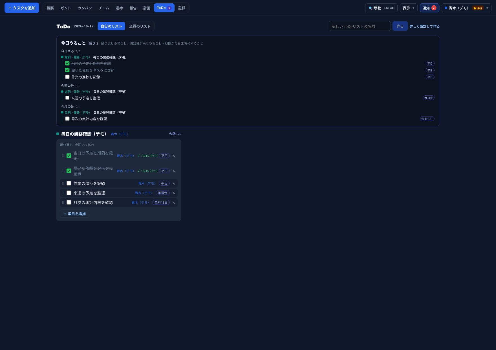
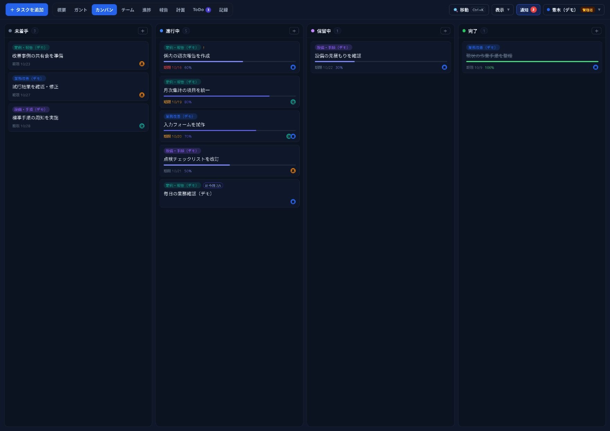
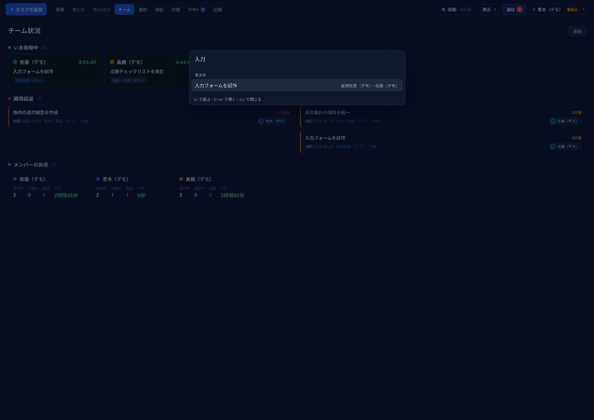
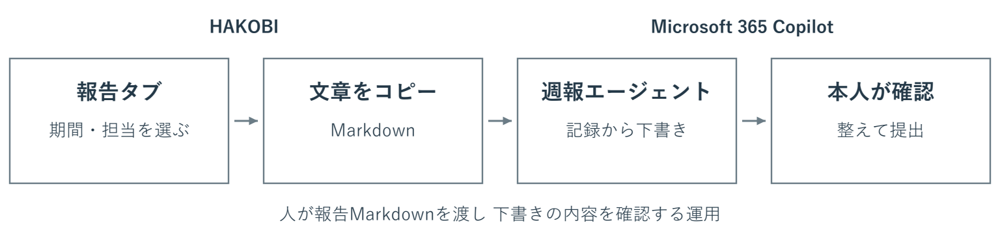
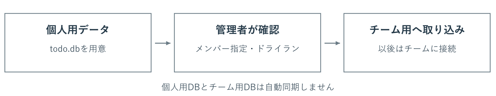

# HAKOBI 利用案内

## 仕事の予定と進捗をチームで共有する

HAKOBI（運び）は日程・担当・進捗をガントチャートで確認できる業務用のタスク管理ツールです。個人の仕事を整理するところから、係やグループでの進捗共有まで使えます。

日々の記録は定例で相談するときや週報をまとめるときの材料になります。仕事の状況を知るために本人へ聞き直したり、報告のたびに一から書き直したりする手間を減らす使い方を紹介します。


### まず自分の仕事を1件登録してみる

期限のある仕事、毎朝の点検、回答待ちの案件など、普段の仕事から試せます。チームで使うときは、ブラウザとデスクトップ版の両方から同じチームのデータを使えます。個人用で作ったタスクをチーム用へ取り込む機能もあります。

この資料では予定の確認、作業中の記録、定例での相談、Copilotを使った週報の下書き作成までを、仕事の流れに沿って説明します。

画面は2026年10月17日確認のプロジェクトから作成したダークモードのデモです。人名・業務名・記録はすべて架空です。

## 最初は1件の仕事で試す

すべての画面や設定を覚える必要はありません。まずは、いま進めている仕事を1件登録し、作業の区切りに短い記録を残してみてください。

### 1 仕事と期限を登録する

「タスクを追加」から仕事の名前、開始日、期限を入力します。チームで使う場合は担当者も決めます。たとえば「月次集計の手順を見直す」のように、何をする仕事か分かる名前にします。

### 2 作業の区切りに進捗を残す

進捗率を更新し、進捗ログに「確認した内容」「次に行うこと」「相談したいこと」を入力します。書き始めに迷ったら「ひな形」を使えます。大きな変化がなければ「予定どおり」で一言の報告を投稿できます。

### 3 報告タブで振り返る

対象期間を選ぶと、仕事の進捗、期間内の記録、期限の変更などをまとめて確認できます。定例や週報の前に、思い出しながら別の一覧を作る手間を減らせます。


### 自分に必要な画面から使う

予定を見るならガント、今日の時間割を考えるなら計画、作業の状況を伝えるなら進捗、定例や週報の準備には報告が向いています。画面を切り替えても、同じタスクを扱います。

## 個人でもチームでも使える

1人で使う場合は、デスクトップ版の個人用モードを選びます。係やグループで使う場合は、社内LANのサーバーを用意し、各自がそのサーバーへ接続します。



| 比較する項目 | 個人用 | チーム用 |
| --- | --- | --- |
| 利用する画面 | デスクトップ版 | ブラウザまたはデスクトップ版 |
| データの保存先 | 自分のPC内 | 社内LANのサーバー |
| 主な使い方 | 自分の仕事や時間を整理 | 担当を分け、進捗と相談を共有 |
| メンバーの管理 | 不要 | 管理者がアカウントを発行 |

### デスクトップ版でもチームに参加できる

チームのサーバーURLを登録すると、ブラウザと同じタスク、担当者、進捗を使えます。チームでの変更はリアルタイムで反映されます。

デスクトップ版のチーム接続には、ミニタイマー、進捗のクイック投稿、トレイ操作、OS通知や未読バッジもあります。メイン画面を開き直す回数を減らして、仕事の区切りに記録する使い方ができます。

個人用の記録をチームへ引き継ぐときは、15ページの取り込み機能を使います。

## ガントで日程と仕事の順序を確認する

朝にガントを開けば、どの仕事がいつまでに必要で、誰が担当し、どこまで進んでいるかを見渡せます。サブタスクを展開すると、業務全体と個々の作業を同じ時間軸で確認できます。


### 日程を動かすとき

バーをドラッグして期間を移動し、左右の端を動かして開始日や期限を調整できます。日・週・月・年の表示を切り替えれば、目先の予定と長い業務の両方を確認できます。

### 前の仕事が終わってから着手するとき

「集計項目を決める→入力フォームを作る」のような順序は、依存関係で結びます。前の仕事が終わってから次の仕事を始める関係で、待機日数も設定できます。前の仕事の日程を変えると、後に続く仕事の日程が計算し直されます。依存関係はガントとタスク詳細のどちらからも編集できます。

### 気になる仕事を絞って見る

カテゴリや検索で対象を絞り込めます。チーム用では担当者でも絞れます。基準線を保存すれば、保存時の日程と現在の日程を比較できます。基準線は各自の端末に保存されます。

バーの色は入力した日程と進捗から計算する目安です。遅れや期限超過が気になる仕事を選び、進捗ログや本人の状況と合わせて確認してください。

## 仕事を分けて担当と状況を明確にする

タスクには業務の目的を書き、具体的な作業をサブタスクに分けます。チームでは主担当・副担当やサブタスクの担当者を設定でき、業務の責任と作業の分担を確認できます。



### 説明とメモと進捗ログを使い分ける

| 入力する場所 | 残す内容 | 例 |
| --- | --- | --- |
| 説明 | 仕事の目的や進め方 | 集計項目の違いを整理し、係で使う様式をそろえる |
| メモ | 現時点の状況 | 関係先へ確認中。回答を受けたら様式を確定する |
| 進捗ログ | 日付つきで積み重ねる報告 | 10月16日　試作を確認。入力項目の追加を相談したい |

詳細画面の説明とメモは入力を止めると保存されます。変更履歴では、誰が何を変えたかをあとから確認できます。

似た業務は複製やテンプレートで登録でき、複数行で入力し、まとめて追加することもできます。同じ入力を繰り返す仕事が多いときに便利です。テンプレートは各自の端末に保存されます。

## 毎日の点検と繰り返す仕事もまとめる

期限へ向かって進める仕事に加え、毎日の点検や週ごとの確認も管理できます。「次回の仕事を作る」場合と、「同じ項目を毎回チェックする」場合で使い分けます。



| 使い分け | 向いている仕事 | 動き方 |
| --- | --- | --- |
| 通常タスクの繰り返し | 週次の資料作成、月次の集計 | 完了すると次回のタスクを作成 |
| ToDoリストの繰り返し項目 | 毎朝の点検、週ごとの確認 | 周期が変わると未チェックに戻る |
| ToDoリストの単発項目 | 点検中に見つかった対応、1回限りの確認 | チェックすると「済み」へ移動 |

### 日々の実施状況も報告に使える

ToDoリストの項目には毎日・平日・毎週・毎月の周期を設定できます。繰り返さない項目には開始日や期限を付けられ、対象の日には「今日やること」に表示されます。

報告タブでは、終わった周期の実施状況と、現在の周期のチェック状況を分けて確認できます。今日や今週の途中経過を、すでに終わった周期の実績と分けて見られます。

## 状態で整理し回答待ちの仕事を残す

カンバンは仕事を状態ごとのカードで見る画面です。「いま進めるもの」「まだ着手しないもの」「完了したもの」を整理したいときに使えます。日程が必要になったら、同じ仕事をガントで確認できます。



### 回答待ちは保留にする

ほかの人の回答や判断を待つときは、タスクを保留にできます。進捗や日付を残したまま止められ、保留を始めた時点と経過期間を報告タブでも確認できます。

メモには「何を待っているか」「何がそろえば再開できるか」を残しておくと、定例で対応を決めやすくなります。保留中だけの絞り込みや、保留が長い順の確認もできます。

保留にすると、そのタスクの計測中のタイマーは停止して作業ログを保存します。チーム用では、同じタスクを計測しているメンバーのタイマーも停止します。再開したら、必要に応じて計測を始めてください。

保留にしただけで期限が消えるわけではありません。期限を変える必要があるときは、日程も合わせて調整します。

## 今日の計画と実際の作業を振り返る

「計画」では今日取り組む仕事を時間割に並べられます。予定を15分単位で調整したり、前日に終わらなかった仕事を繰り越したりできます。予定が変わったときは、後ろの予定をまとめて移せます。


### 作業を始めたらタイマーで記録する

タスクにひも付けて計測すると、作業ログに時間が残ります。あとから「記録」で作業内容や時間を確認し、日々の仕事の振り返りに使えます。計画は予定、作業ログは実際に記録した時間として扱います。


デスクトップ版のチーム接続ではミニタイマーやトレイからの開始・切り替え・停止も使えます。チームの「いま稼働中」に出るのは、このタイマーで計測中の仕事です。

## 短い進捗ログから相談につなげる

仕事の区切りに進捗ログを残すと、ほかのメンバーも状況を確認できます。記録はタスクにひも付くため、相談の経緯を仕事と一緒に振り返れます。


### 書き始めはひな形を使う

「ひな形」を押すと、「やったこと：」「次にやること：」「困っていること：」を入力欄に入れられます。毎回長い文章を書く必要はありません。判断に必要な変化や確認したいことを短く残します。

「予定どおり」は「予定どおり進んでいます。」をそのまま投稿するボタンです。入力途中の文章があるときは使えません。

### 話し合いたい内容には要相談の印を付ける

判断や支援が必要な進捗ログには「要相談」を付けられます。報告タブにもまとまるので、定例で取り上げる内容を見つけやすくなります。相談が済んだら印を外します。

返信やリアクションで確認を伝えられ、@名前で相手に知らせる使い方もできます。チーム用では新着表示や通知から、ほかの人の投稿・返信を確認できます。

## チームの状況を見て必要な仕事を開く

チーム画面では、メンバーがタイマーで計測している仕事、期限が近い仕事や期限を過ぎた仕事、担当件数などを確認できます。仕事の偏りや手助けが必要な案件を話し合う材料になります。


### 探すときはCtrl＋K

Ctrl＋Kで移動・操作のパレットを開けます。タスク名、カテゴリ、担当者を手掛かりに仕事を探したり、画面を切り替えたり、タスクを追加したりできます。



チーム接続ではタスク詳細のリンクをコピーしてチャットなどに貼れます。相手も同じサーバーにログインすると、その仕事の詳細を開けます。

自分の期限や最近の動きをまとめて見たいときは「概要」も使えます。担当やカテゴリで絞り込んだ状態は見出し付近に表示され、その場で解除できます。

## 報告タブで定例と週報の材料を確認する

報告タブは日々の記録を読み返すための画面です。期間を選び、担当者別またはカテゴリ別に、進捗、期限、メモ、進捗ログと返信を確認できます。


### 会議の前に見るところ

- 期間中に何が進んだか。進捗の変化と進捗ログを合わせて確認します。
- どこに判断や支援が必要か。「要相談」と保留の理由を確認します。
- 期限を調整する必要があるか。期限の変更や、報告がしばらくない仕事を確認します。

この画面からも進捗率、期限、メモ、サブタスク、進捗ログを更新できます。定例で決まった内容を反映するために、毎回詳細画面へ戻る必要はありません。

### 表示対象を決めてからコピーする

週報に使う場合は、対象期間、担当者、必要なサブタスクの表示範囲を確認し、「Markdownをコピー」を押します。進捗や記録を見出しや箇条書きの付いた文章でコピーできます。表計算で扱うときはCSV出力も使えます。

「期間内の報告なし」は期間内の進捗ログやメモ更新がないことを示します。仕事をしていないという判断には使わず、本人へ状況を確認してください。

## 定例で相談し決まったことをタスクにする

報告タブを担当者別の表示にして「定例モード」を開くと、担当者ごとに大きく表示して進められます。持ち時間を選び、経過時間を確認しながら、順番に報告と相談ができます。


### 要相談から話し始める

事前に付けた要相談の内容と進捗ログを読み、判断が必要な点を確認します。進捗率や期限もその場で更新できます。

### 次の仕事をその場で作る

追加の確認や対応が決まったら、定例モードからタスクを作成できます。会議で話した内容を、担当者の次の仕事へつなげられます。作成後は、必要な期限や詳しい内容を確認してください。

### 終わる前に定例の内容をコピーする

定例メモ、追加したタスク、担当者ごとの時間は「定例の内容をコピー」でまとめて取り出せます。定例メモは報告画面を離れると消えるため、残す場合は先にコピーし、議事録などへ貼り付けてください。

管理者が定例の曜日を設定すると、条件に当てはまる未報告の担当タスクについて、前日の17時以降に報告を促す通知を出せます。日々の記録と合わせて定例前の確認に使えます。

## 週報はCopilotのエージェントで下書きする

毎回同じ形式の週報を作るなら、Microsoft 365 Copilotに週報用のエージェントを用意する使い方がおすすめです。書き方の指示を保存しておき、毎週HAKOBIの報告Markdownを渡して下書きを依頼します。



### 最初に1回エージェントを作る

1. Microsoft 365 Copilotを開き、「エージェント」から「新しいエージェント」を選びます。
2. 「HAKOBIの報告Markdownを元に週報を作るエージェントを作成したい」と伝えます。
3. 「構成」で名前と指示を確認します。名前は「HAKOBI週報作成」などにし、次のページの指示例を保存します。
4. サンプルのMarkdownで試し、書式と内容を確認して作成します。

作成機能の表示は、組織の設定やアカウント、ライセンスにより異なります。

### 毎週は記録を渡して依頼する

報告タブで期間と担当者を選び、「Markdownをコピー」を押します。作成したエージェントを開き、コピーしたMarkdownと週報作成の依頼を貼り付けます。

下書きが出たら、担当者、期限、進捗率、相談事項、未確定の内容を確認して提出します。この例は、人がMarkdownを渡し、内容を確認する運用です。

出典：Microsoft公式「独自のエージェントを構築する」「Build agents in Agent Builder」を参照。2026年10月17日確認。

[Microsoftのエージェント作成手順](https://support.microsoft.com/ja-jp/microsoft-365-copilot/build-your-own-agent-with-microsoft-365-copilot)
[Microsoft Learnの構成とテストの説明](https://learn.microsoft.com/en-us/microsoft-365/copilot/extensibility/agent-builder-build-agents)

## 週報用エージェントに保存する指示の例

以下は、この運用のための指示例です。係で使う週報の書式が決まっていれば、出力の見出しや長さを調整してください。

### エージェントの指示欄に保存する

```text
あなたは係内の週報の下書きを作成する担当です。
今回の依頼に貼り付けられたHAKOBIの報告Markdownと、依頼者が明示した補足だけを根拠にしてください。

最初に対象期間と担当範囲を確認してください。不明な場合は確認を求め、推測で埋めないでください。
業務ごとに内容をまとめ、次の見出しで簡潔な日本語の週報を作成してください。
1. 今週の主な実施内容
2. 継続中の仕事と現在の状況
3. 相談事項と保留中の仕事
4. 次に行うこと
5. 提出前に確認すること

担当者、期限、進捗率、保留の理由は、記録の内容を保ってください。
期間中の進捗の変化と現在の進捗率を混同しないでください。
要相談の記録と返信を読み、解決したと確認できない内容を解決済みにしないでください。
「期間内の記録なし」を「実施していない」という意味に受け取らないでください。
次の作業は記録に明示されたものだけを挙げ、来週の予定や成果を創作しないでください。
足りない情報や食い違いは「提出前に確認すること」に分けてください。
同じ内容は重複させず、業務名と具体的な動きが伝わる文章にしてください。
```

### 毎週のチャットで依頼する

```text
次のHAKOBIの報告Markdownを元に、週報の下書きを作成してください。
対象期間：2026年10月12日〜16日
担当範囲：佐藤（デモ）の主担当業務
提出先：係内の共有
文体：です・ます調
下に貼るMarkdownの期間と担当範囲も確認してください。

ここに「報告」タブからコピーしたMarkdownを貼り付ける
```

この依頼例の日付と担当範囲は、その週の内容へ置き換えます。週報の書式をエージェントに保存しておけば、毎週の依頼は対象期間と記録を中心に入力できます。

## 使い始め方と個人用データの引き継ぎ

### すでにチームのサーバーがある場合

管理者にサーバーURLとアカウントを確認し、ブラウザでログインします。デスクトップ版を使う場合も、接続先に同じサーバーURLを登録します。インストーラーはサーバーの「/download」ページから入手できます。

最初は自分の担当業務を1件登録し、進捗ログを1件残して、報告タブに出ることを確認してください。ほかのメンバーにも同じ仕事が見えるか、一緒に確かめると使い方を共有できます。

### 個人で使い始める場合

デスクトップ版で個人用を選びます。自分の仕事を登録し、ガントと進捗ログから試せます。設定の「個人」ではダーク、ライト、OSに合わせる表示を選べ、フォントや表示倍率も調整できます。チーム接続では自分のパスワードも変更できます。

### 個人用で作ったタスクをチーム用へ移す場合



チームの管理者が設定の「チーム管理」から「デスクトップDBを取り込む」を押します。個人用のtodo.dbと取り込み先メンバーを選び、まず「ドライラン（確認のみ）」で件数を確認してから実行します。

タスク、サブタスク、依存関係、作業ログ、予定、進捗ログや返信、変更履歴などを引き継げます。投稿者や担当は指定したメンバーとして取り込まれます。

取り込みは個人用からチーム用へのコピーです。取り込みをもう一度実行しても、すでに取り込んだデータは更新されません。取り込んだあとも、個人用DBとは自動で同期しません。設定や実行中タイマーなどは対象外です。

## 係やグループで広げるための準備

最初からすべての業務を登録せず、定例で確認している仕事や、状況を聞き直すことが多い仕事から試してみてください。同じ記録を定例と週報へ使えるかを確認すると、自分たちに合う運用を考えやすくなります。

### 試用するメンバーでそろえること

- 最初に扱う業務と主担当を決める。
- 作業の区切りに進捗ログを残し、判断が必要なら要相談を付ける。
- 定例では報告タブを開き、決まった対応をタスクへ戻す。
- 週報は報告Markdownから下書きを作り、提出前に本人が確認する。

### 運用担当者が用意すること

チーム用のサーバーは社内LANでの利用を想定しています。サーバーの保存先、接続先URL、管理者、メンバーのアカウントを用意します。グループごとにデータを分ける場合は、サーバーとDBの保存先を分けて運用します。

設定の「チーム管理」にはユーザー管理、定例の曜日、個人DBの取り込み、バックアップがあります。「データ」ではエクスポートなどの操作を確認できます。

サーバーには1日1回の自動バックアップ機能があり、設定で自動バックアップを止めたり、保存する数を変えたりできます。管理者は現在のDBをダウンロードすることもできます。復元はサーバーを止めてDBを差し替える手順なので、保存先と復元方法を運用担当者が確認しておきます。

### 利用中に知っておきたいこと

チーム用はサーバーへの接続が必要です。再接続中の帯が表示されたときは、接続状態を確認してください。カテゴリの「集計外」は集計対象を分ける設定で、ほかの人から見えなくする設定ではありません。

まずは、いまの仕事を1件登録してみてください。日々の短い記録を、チームの確認と相談に使ってみてください。

詳しいサーバー準備、配布、更新、バックアップの復元手順は、プロジェクト内の「HAKOBI 運用ガイド」（docs/HAKOBI.md）を参照してください。
