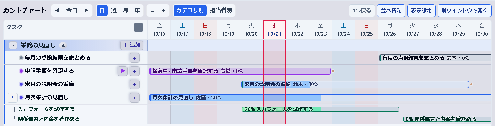
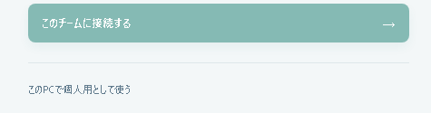
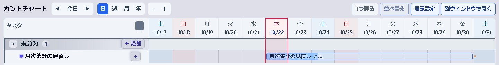
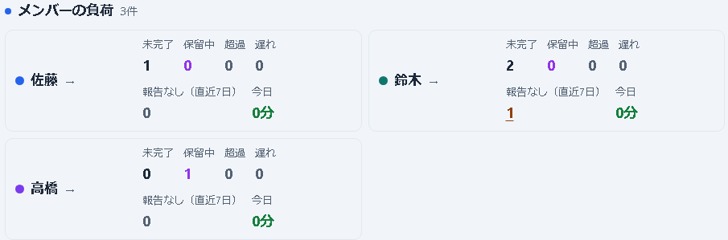
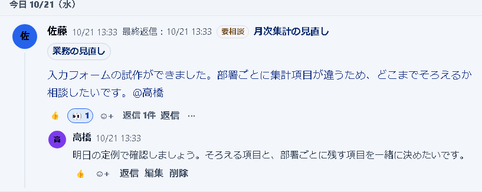
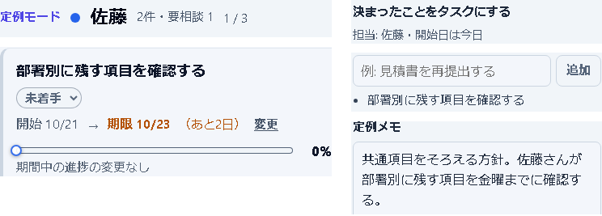
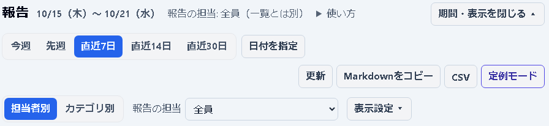

# HAKOBIで予定と進捗を共有する

## どこまで進んだかを同じ画面で確かめる

「あの仕事、どこまで進んだ？」「誰に相談すればいい？」。HAKOBI（ハコビ）は、仕事の日程・進捗・相談をまとめて扱えるタスク管理ツールです。自分のPCでひとりで始め、チームでは担当と期限を共有して使えます。

### この資料で紹介する使い方

自分の仕事を登録して日程を確かめる。チームで困ったことを相談し、定例で決まった対応を次の仕事へ。週報も日々の記録から材料を取り出せます。

月次集計の見直し、説明会の準備、関係先からの回答待ちなど、日程のある仕事から試せます。個人用はチームサーバー不要。チーム利用には社内LANのサーバーと、管理者が発行するアカウントが必要です。

### いまの状況から始める

ひとりで試す人は次のページへ。チームで使う場面は3〜5ページ、入手や準備の案内と試用の確認は6ページにあります。

詳しい機能と操作は、同封の[はじめ方ガイド](HAKOBI_はじめ方ガイド.html)へ。画面の人名・仕事・やり取りは架空です。チーム画面は2026年10月21日、個人用画面は10月22日の実アプリで撮影しました。導入効果を測定した報告ではありません。

## まず自分の仕事をひとつ登録する

個人用では、仕事と記録を自分のPC内に保存します。チームのアカウントを作らずに試せます。Windows用インストーラーを配布担当者から受け取って起動し、接続画面の下にある「このPCで個人用として使う」を押します。

### 登録した仕事が予定になる

「タスクを追加」で仕事の名前・開始日・期限を入れます。「ガント」は日程を横棒で並べる画面です。例では「月次集計の見直し」を登録し、進捗を25%にしています。

作業の区切りにタスク詳細の「進捗ログを書く」から、できたことと次にやることを残します。日付付きで積み上がるので、後から経過を見返せます。時間帯を決める「計画」、作業時間のタイマー、状態で分けるカンバンも使えます。

入手先がまだなければ、6ページの準備担当者向け案内へ。個人用の起動と登録は[ガイド01](HAKOBI_はじめ方ガイド.html#solo)、その他の機能は[画面で見る機能紹介](HAKOBI_はじめ方ガイド.html#features)で確認できます。

## 担当と期限をチームで見渡す

チームで使うと、同じ仕事の担当・期限・進捗をメンバー同士で共有できます。ガントで仕事ごとの予定を見渡し、「チーム」でメンバーごとの状況を確かめます。

### ひとりで残した仕事を引き継ぐ

個人用とチーム用は保存先が別です。チームへ接続するだけで、個人用の仕事が移るわけではありません。引き継ぐときは、バックアップを残し、管理者が個人用DBをチームへ取り込みます。

取り込みは一方向のコピーで、元の個人用DBとの継続的な同期ではありません。管理者が取り込み先のメンバーを選び、試し読みの結果を確認してから実行します。詳しい対象と操作は[ガイド02](HAKOBI_はじめ方ガイド.html#move)へ。

### メンバーは同じ接続先へ

管理者からURLとアカウントを受け取り、ブラウザでログインします。各メンバーのPCへのインストールは必須ではありません。デスクトップ版から同じチームへ接続することもでき、変更はリアルタイムで共有されます。

メンバーは確認や相談に、リーダーは分担と期限の見直しに使えます。件数や進捗率だけで判断せず、仕事に残った事情と一緒に見ます。共同作業の例は[ガイド03](HAKOBI_はじめ方ガイド.html#team)にあります。

## 困ったことをその仕事で相談する

「入力フォームの試作はできたけれど、集計項目をどこまでそろえるか決めたい」。そんなときは、その仕事に進捗ログを書き、判断や手助けが必要なら「要相談」を付けます。

### 相手と相談したい内容を伝える

「@高橋」のように名前を書くと相手に通知され、返信は元の投稿の下に残ります。相談を仕事の名前・担当・期限と一緒に追えるので、後から見返すときも内容を確かめられます。

### 書くのは短くて大丈夫

投稿欄では「やったこと」「次にやること」「困っていること」のひな形を使えます。大きな変化がない日は「予定どおり」を押し、一言を入れて「投稿」で送れます。

例では、佐藤さんが相談を書き、高橋さんが定例で確認すると返信しています。次は、この相談を見ながら対応を決めます。詳しい操作は[ガイド03の相談の例](HAKOBI_はじめ方ガイド.html#team)へ。

## 定例の決定を次の仕事と報告へ

「報告」で期間を選ぶと、日々の進捗ログや要相談の内容を見直せます。「定例モード」では担当者ごとに確認しながら、次の対応を決められます。

### 決まったことを担当と期限のある仕事に

月次集計の例では、定例で「共通項目をそろえる」と決めました。「決まったことをタスクにする」に仕事名と期限を入力し、「追加」で佐藤さんの仕事として残しています。会議の後も対応を追えます。

議事録は「議事録をコピー」で取り出して保存します。途中経過は使っている端末に12時間残りますが、長期保存の代わりにはならないので、終わったら議事録を保存します。

### 週報も日々の記録を材料に

集計項目を相談した経過や期限の変更を確かめ、必要な部分を普段の報告先へ貼り付けます。上部の設定が見えなければ「変える」を押します。報告先に合う文章へ仕上げる前に、担当・期限・相談内容を自分で確認してください。

## ひとつの仕事で使い続けられるか試す

まずは身近な仕事を選び、個人用なら登録と記録を、チームなら相談と返信まで試してみてください。次の定例で、状況が分かったか、相談に使えたかを振り返ります。

### 自分に合う入口を選ぶ

ひとりで試す人：配布担当者からインストーラーを受け取ります。既存サーバーがあれば、そのURLの末尾に「/download」を付けた配布ページからも入手できます。[ガイド01](HAKOBI_はじめ方ガイド.html#solo)へ。

既存チームへ参加する人：管理者からURL・ユーザー名・初期パスワードを受け取り、ログインしてパスワードを変更します。[ガイド03](HAKOBI_はじめ方ガイド.html#team)へ。

新しく準備する人：入手先がなければ、管理担当者へこの資料と試したい仕事・参加者を渡します。準備担当者は[ガイド04](HAKOBI_はじめ方ガイド.html#setup)のビルド・配置手順へ。exeを受け取る利用者に開発環境は不要です。

### 始める前に気になること

個人用での利用：個人用ならチームサーバーは不要です。チームへのデータ移行は管理者による取り込みが必要です。

週報との二重入力：ログから材料を取り出せます。試用時に、既存報告のどの部分を置き換えるかを決めます。

社内利用の確認：利用の可否は社内ルールと管理担当者へ確認してください。チーム用は社内LANでの利用を案内しています。

### 試用の最後に確かめる

個人用では、仕事と進捗ログを登録し、再起動後も残るか確認します。チームでは別の人が返信し、定例で決めた対応を担当・期限付きで残せたか確認します。

続ける場合は「いつログを書くか」「誰が相談を確認するか」「相談が済んだ印と議事録をどう残すか」を決めます。ガイドの[試用の確認リスト](HAKOBI_はじめ方ガイド.html#check)も使えます。難しかった点を残し、いまの仕事に合う使い方を選んでください。
